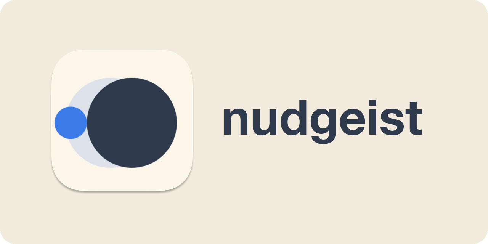

<p align="center"><a href="https://nudgeist.github.io/"></a></p>

# nudgeist

**A nudge, not a switch.**

Before your message reaches an expensive model, nudgeist asks a fast, low-cost one if the task really needs it and suggests a lighter model for that turn. You decide.

```
❯ fix the typo in README: recieve

  nudgeist: Haiku can likely handle this: single typo fix in README, mechanical edit.
  This turn on Haiku: put /nudgeist:haiku in front and send.
  Stay on Opus 5.5: send it again unchanged.
```

The notice quotes your message back, so nothing is lost. Send it with `/nudgeist:haiku` in front, or send it again unchanged to keep your model. Either way, your next message runs on the model and effort you chose for the session. After the first turn on a 5.5 model, a notice suggesting a lighter model also shows the estimated cost of both options.

## Install

In Claude Code:

```
/plugin marketplace add nudgeist/nudgeist
/plugin install nudgeist@nudgeist
```

It needs Node.js 18 or later: the hooks run with `node`.

**Two editions.** This repository is the full edition, with the hooks that look at each message before it's sent. Anthropic's plugin directory accepts background hooks only from Verified organizations, so the edition submitted there carries only the five commands, with no hooks and no code. [Its README](https://github.com/nudgeist/nudgeist/tree/directory#readme) has the details.

## How it decides

1. **What you're running.** It reads the model and effort of your last turn from the session transcript, and Claude Code tells it about `/model` as it happens. An `/effort` change counts once a turn has run on it. Before the first turn it uses the model the session started with.
2. **Whether anything can be saved.** If you're already on a model and effort with nothing cheaper to offer, it does nothing and adds no wait.
3. **A second opinion.** Haiku reads your message plus a few lines about the session: its title, the project folder's name, your last requests, the end of Claude's last reply, the files in play with their sizes, and the size of the conversation. It doesn't open your files. It answers with a model, an effort, a confidence and a reason, and says whether your message starts new work. A yes, an ok or a question about progress continues the work already under way, so it keeps your model and effort.
4. **Whether switching pays.** A model you haven't used in this session has to read the whole conversation from scratch, while your current model reads it from the prompt cache at a fraction of its usual price. nudgeist does that arithmetic with list prices and the cache lifetime your session actually uses, and only suggests a model when it at least halves the turn's cost. When it doesn't pay, it may suggest a lower effort instead, which on the 5.5 models and Fable 5.1 with a Claude plan or an Anthropic Console account keeps the cache.
5. **One question, then quiet.** It holds a message once. If you keep your model twice in a row, it stays quiet for the rest of the session.

## Commands

| Command | Runs this one message on |
|---|---|
| `/nudgeist:haiku <message>` | Haiku |
| `/nudgeist:sonnet <message>` | Sonnet |
| `/nudgeist:low <message>` | your model at low effort |
| `/nudgeist:medium <message>` | your model at medium effort |

`/nudgeist:check <message>` asks Haiku which of these that message needs, without doing the work.

## What it costs

Each checked message costs one Haiku call: about 1,200 tokens and usually about 2 seconds (median 1.9 s; 27 of 36 calls took 1.5 to 3 s, 2 took over 8 s), measured on Claude Code 2.1.296. Messages with nothing to save aren't checked, and a call that takes longer than 8 seconds lets your message through without a notice.

## How it's checked

- `npm test`: the session reader, the cost arithmetic, the advisor's reply parser and the hold-once logic.
- [`bench/`](bench/): twelve coding tasks graded by hidden tests, solved on Haiku and Opus, with every raw run, diff and advisor call published and hashed. On 2026-10-13 Haiku 5.5 passed all twelve. Of 36 advisor calls, 16 suggested Haiku and 20 held back; none suggested Haiku where it failed, but since Haiku never failed, that risk is still untested. Those runs used an earlier version of the session brief. The tasks, the sample sizes and what they don't cover are in [the limits](bench/README.md#limits).

## What it reads, writes and sends

- **Reads** up to the last 512 KB of the session transcript, which can include what Claude read from your files, and the size of the files in play, on your machine. It never opens those files, and only what's listed under Sends leaves your machine.
- **Writes** a small state file per session in the plugin's data folder: the session's model, a fingerprint (SHA-256 hash) of the message on hold, never its text, how many notices it showed, how often you accepted or kept your model, and whether it went quiet. Files of sessions idle for a week are removed.
- **Sends** your message and the session brief to Haiku by running your own Claude Code once per checked message, which counts toward your usage. Claude Code adds its usual context, listed in the privacy policy. They normally go wherever your Claude Code sends your messages: Anthropic, or the gateway or cloud provider you set up. That run has no tools, doesn't load your settings files, so a sign-in script set only there doesn't apply to it, and turns off its own auto memory, updater and telemetry. nudgeist has no server of its own and no telemetry.

The [privacy policy](PRIVACY.md) has the details.

## When it stays out of the way

- Commands (`/...`), `claude -p`, SDK and background sessions are never held.
- Any error, timeout or unclear verdict lets the message through.
- `NUDGEIST=off` turns it off.

## Limits

- The advisor sees a summary, not your code, so it can be wrong. That's why it asks instead of switching.
- In the desktop app the first message of a session isn't checked: Claude Code doesn't tell hooks the model there until the first turn.
- Prices are list prices for the 5.5 models. An older model you're running is priced as its 5.5 family member, which understates savings. The lighter model is always priced as its 5.5 version, so on a cloud provider where `haiku` or `sonnet` means an older model, savings are overstated. On a subscription you pay a plan, not per token, so treat the figures as a rough guide.

## Also by the author

- [ThinWindow](https://thinwindow.github.io/): keeps long Claude Code sessions cheap. It trims oversized reads and logs, and shows what an expired session costs before you pay it.
- [antiagree](https://antiagree.github.io/): a reviewer with no stake in your plan. It checks the plan against your code and data, tries to kill it, and gives a GO / ITERATE / RETHINK / KILL verdict.

## License

MIT
